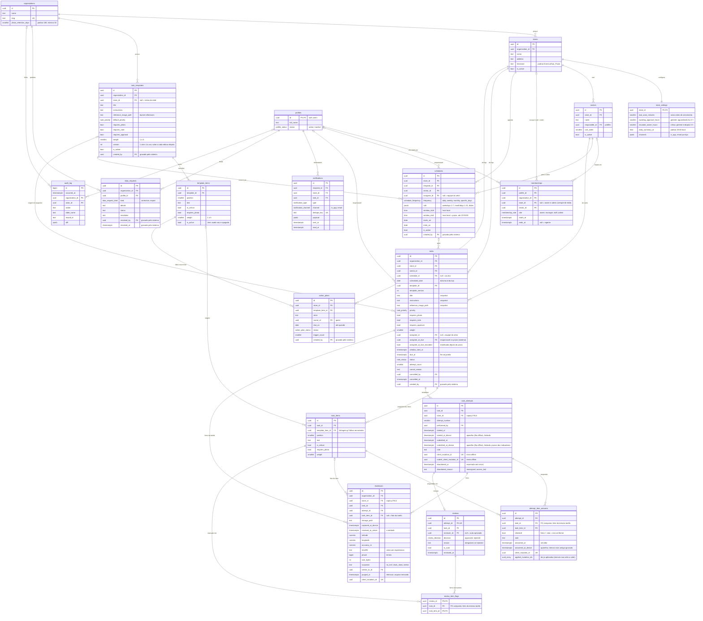
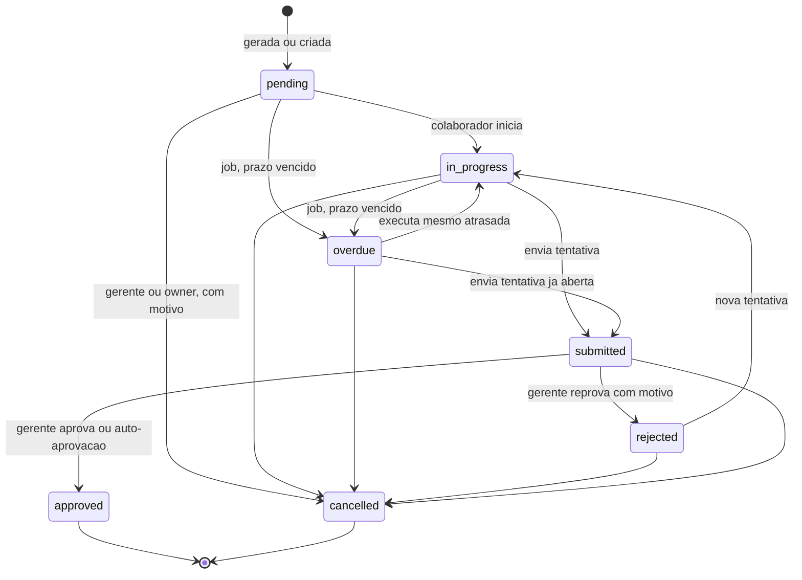

# Modelo de dados — Éde Gestão

> Proposta da Fase 0, implementada na Fase 1 em `supabase/migrations/` (este documento acompanha as migrations; divergência é defeito).
> Nomes em inglês `snake_case`, comentários (`COMMENT ON`) em português.
> Toda tabela tem `id uuid` (exceto `audit_log`, que usa `bigint identity` para ordem estável) e `created_at` / `updated_at` quando aplicável.
> Tabelas marcadas com ➕ não estavam na lista original; a justificativa está em `docs/decisoes.md`.

## 1. Diagrama entidade-relacionamento

Versão em imagem: [`diagramas/modelo-er.png`](diagramas/modelo-er.png) · [`diagramas/maquina-de-estados.png`](diagramas/maquina-de-estados.png).

## 2. Máquina de estados da tarefa

Implementada no banco: função `task_status_transition_allowed(old, new)` + trigger `BEFORE UPDATE OF status ON tasks`. Transição fora do grafo levanta exceção, para qualquer papel (inclusive `service_role`).

Regras adicionais no banco:

- `requires_approval = false` → no envio, a função `submit_attempt` grava `reviews(is_auto = true, reviewer_id = null, decision = 'approved')` e leva a tarefa a `approved` na mesma transação.
- `rejected` exige `reviews.reason` não vazio (`CHECK`) e incrementa a próxima tentativa (`attempt_count`).
- Sem exigência de aprovação, mas com item respondido como **não conforme**, a tentativa não é auto-aprovada: vai para o gerente (`submitted`).
- `cancelled` exige `cancel_reason` (texto de verdade: ao menos uma letra ou um número) e papel `manager` (da loja) ou `owner`. O gerente só cancela tarefa `pending` ou `in_progress` cujo prazo ainda não venceu e que **nunca teve tentativa enviada**; vencida, enviada ou reprovada (mesmo já reiniciada) só a proprietária cancela (`owner_only`), para a falha não sumir dos indicadores.
- `approved` e `cancelled` são terminais: depois deles **nenhuma coluna** da tarefa muda, nem os itens dela, para nenhum papel (`task_closed`). Itens (`task_items`) só mudam com a tarefa `pending` e sem tentativas. Tarefa não é apagada (nem pela chave secreta).
- Tarefa criada pela API (usuário logado) nasce com prazo no futuro. O prazo (`due_at`) só muda com a tarefa `pending`, `in_progress` ou `rejected`, antes de vencer e nunca para o passado; o início da janela (`window_start_at`) só muda com a tarefa `pending`, sem tentativas, antes do prazo e nunca para o passado (`deadline_locked`). A criação pela API e toda edição de título, instruções, imagem, prioridade, responsável, janela ou prazo ficam no `audit_log`.
- Reatribuir depois do prazo é permitido; na primeira troca o banco grava quem era o responsável no prazo (`assignee_at_due`), usado nos indicadores. A falha da tarefa vencida fica com quem estava com ela no prazo, mesmo que a tentativa dessa pessoa seja encerrada depois numa passagem (D74).
- Responsável (tarefa e agendamento) é sempre colaborador ativo da loja (`invalid_assignee`): gerente, proprietária e perfil inativo não executam (D86). Na tarefa, o vínculo precisa começar antes do prazo (ou já ter começado, se o prazo passou); agendamento aceita quem começa no futuro, e a geração manda a tarefa do dia para a equipe do setor enquanto o responsável fixo não começou (D100).
- **Passagem da tarefa** (a tarefa não fica presa a quem saiu): ao reatribuir, a tentativa aberta de quem deixou de ser o responsável é **encerrada sem envio** na hora (`task_attempts.abandoned_at`, pelo relógio real do servidor, `abandoned_reason = reassigned`, no `audit_log` como `attempt_abandoned`); o mesmo acontece na hora em que a pessoa muda de setor (`reassigned`), tem o vínculo encerrado agora ou apagado ou o perfil desativado (`access_lost`) (gatilhos em `memberships` e `profiles`, D82). Com fim de vínculo agendado, a tentativa é encerrada quando outra pessoa que pode executar a tarefa a inicia. O início trava os vínculos de colaborador e o perfil de quem inicia antes da tarefa: um início no meio de uma mudança de vínculo ou perfil espera o commit e recebe `forbidden` (D97). A tentativa encerrada fica no histórico e congela (sem respostas, fotos ou envio); a tarefa continua `in_progress` (ou `overdue`) e o novo responsável inicia a tentativa seguinte. Quem saiu não responde, não registra foto e não envia a tarefa de outra pessoa (`forbidden`, conferido depois das travas). Enquanto quem iniciou ainda pode executar a tarefa, ninguém a toma dele (`invalid_transition`).
- Iniciar exige a janela aberta: antes de `window_start_at` a tarefa não começa (`window_not_open`). O acesso (tarefa dele ou da equipe do setor) é conferido de novo depois da trava: quem deixou de ser o responsável enquanto esperava não inicia (`forbidden`). Na fila offline, `start_attempt` recebe o horário do aparelho em que a pessoa abriu a tarefa (`started_at_device`, D72), limitado entre o início da janela (ou a criação, ou o fim da tentativa anterior; a tentativa velha encerrada nesse mesmo início vale pelo início dela, D98) e a hora do servidor; `started_at` continua sendo a hora do servidor. Do mesmo jeito, `submit_attempt` recebe o horário do aparelho em que a pessoa tocou em "Enviar" (`submitted_at_device`, D94), limitado entre o início da tentativa (ou a última resposta) e a hora do servidor; ele vale para os prazos dos indicadores.
- Envio exige: todos os itens respondidos — **feito** (marcado) ou **não conforme** (desmarcado com observação); foto em cada item com `requires_photo` e, se a tarefa tem `requires_photo`, ao menos uma **foto geral da tarefa** (`evidences.task_item_id` nulo) além das fotos dos itens (a foto precisa existir no bucket `evidences` e, com EXIF, não pode ser anterior ao início da tentativa — o do aparelho, quando veio da fila offline: `photo_before_start`, 10 min de tolerância); observação se `requires_note`.
- `submitted` **nunca** entra em contagem de concluídas (as views só contam `approved`).

## 3. Enums

| Enum | Valores |
|---|---|
| `membership_role` | `owner`, `manager`, `staff`, `admin` |
| `profile_status` | `active`, `inactive` |
| `task_status` | `pending`, `in_progress`, `submitted`, `approved`, `rejected`, `overdue`, `cancelled` |
| `task_priority` | `low`, `normal`, `high`, `urgent` |
| `schedule_frequency` | `daily`, `weekly`, `monthly`, `specific_days` |
| `review_decision` | `approved`, `rejected` |
| `action_plan_status` | `open`, `in_progress`, `done`, `cancelled` |
| `notification_channel` | `in_app`, `email` (push e WhatsApp entram depois por migration aditiva) |
| `notification_type` | `due_soon`, `overdue`, `correction_requested`, `recurring_reminder`, `awaiting_approval`, `escalation_manager`, `escalation_owner`, `daily_summary`, `task_cancelled`, `sync_conflict` |
| `data_request_kind` | `correction`, `export` |

## 4. Integridade e idempotência

| Regra | Como |
|---|---|
| Geração diária não duplica | `UNIQUE (schedule_id, scheduled_date)` + `INSERT … ON CONFLICT DO NOTHING` |
| Reenvio offline não duplica | `client_mutation_id uuid UNIQUE` em `task_attempts` (início), `evidences` e `attempt_item_answers` (`submit_client_mutation_id` no envio); reenvio devolve o registro existente, também quando o mesmo pedido chega duas vezes ao mesmo tempo (conferido de novo depois das travas) |
| Reenvio atrasado não desfaz resposta | a resposta do item é um upsert por item com o horário do aparelho (`answered_at_device`, no máximo o do servidor): resposta mais antiga que a gravada (fila reordenada) é ignorada e `answer_item` devolve `false`, também depois do envio (D88); sem horário do aparelho, vale a ordem de chegada (o aparelho manda o horário em toda resposta, online inclusive). Todo `client_mutation_id` já aplicado ao item fica em `applied_mutation_ids` (os 200 mais recentes): o reenvio de uma resposta já substituída por outra mais nova não muda nada e devolve `false` (D93) |
| Foto repetida é bloqueada | `UNIQUE (organization_id, sha256)` em `evidences` (vale mesmo após `purged_at`) |
| Vínculos sem sobreposição | `EXCLUDE USING gist (profile_id WITH =, organization_id WITH =, store_id WITH =, role WITH =, tstzrange(starts_at, ends_at) WITH &&)` (extensão `btree_gist`) |
| Uma pessoa, uma organização | gatilho `memberships_single_organization` (BEFORE): recusa vínculo de perfil inexistente, de quem já tem vínculo em outra organização ou cuja conta foi criada para outra (`auth.users.raw_app_meta_data.organization_id`); pela API, o 1º vínculo exige a conta criada para esta organização — sempre `profile_other_organization` (mesma resposta nos quatro casos) |
| Organização sempre com proprietária | gatilho `memberships_protect_last_owner`: encerrar, adiar ou apagar o último vínculo vigente de proprietária é recusado (`last_owner`, 23514) |
| owner/admin só de rede | `CHECK ((role in ('owner','admin')) = (store_id is null))`; gerente e colaborador sempre com loja |
| Referências na mesma organização/loja | gatilhos de validação (erro 23514, mesma chave para id inexistente e alheio): rotina da tarefa da mesma organização e da rede ou da mesma loja (`invalid_template`); responsável da tarefa/agendamento colaborador ativo com vínculo não encerrado na loja (`invalid_assignee`, `private.can_be_assignee`); responsável do setor com vínculo na loja ou de rede (`invalid_responsible`); responsável do plano gerente/colaborador da loja ou proprietária, nunca admin (`invalid_owner`); linhagem `task_items.template_item_id` só da rotina da tarefa e item do plano de rotina da rede ou da loja (`invalid_template_item`); imagem de referência em `{org}/{loja ou rede}/{rotina ou tarefa}/{uuid}.{jpg,png,webp}` da própria organização (`invalid_reference_path`) |
| Validação não vira oráculo | os gatilhos BEFORE rodam antes do `WITH CHECK` da RLS: quem grava pela API sem poder gravar no destino recebe antes o mesmo erro da RLS (42501), sem nenhuma consulta; a validação só roda para quem pode gravar ali |
| id gerado pelo banco | a API não informa `id` no INSERT (privilégio de coluna): chave primária repetida não revela ids de outra organização |
| Autor não forjável | `created_by` de rotinas, agendamentos, tarefas e planos é gravado por gatilho com o usuário logado (sistema/chave secreta = nulo; o informado é ignorado) e não muda depois; `data_requests.resolved_by`/`resolved_at` são gravados ao concluir o pedido |
| Item da mesma tarefa | `attempt_item_answers` e `review_item_flags` têm `task_id` e FKs compostas `(attempt_id, task_id)`/`(review_id, task_id)` e `(task_item_id, task_id)` |
| Tamanhos limitados | `CHECK` nas colunas de texto/jsonb gravadas pela API (título 200, instruções 4.000, item 500, motivo 1.000, observação 2.000, regra do agendamento 4 KB só com `weekdays`/`monthdays`/`dates`, canais 2 KB...); no diff do `audit_log`, valor acima de 2 KB vai resumido (`truncated`, `bytes`, `sha256`, `prefix`) |
| Linhagem das falhas recorrentes | `task_items.template_item_id` com `ON DELETE RESTRICT`: item de rotina já usado em tarefa não é apagado, é desativado (`template_items.is_active`); a geração copia só itens ativos |
| Texto "em branco" | `private.is_blank()`: lista de permissão — em branco é o texto sem nenhuma letra (alfabeto latino, com acentos) nem número (motivos de reprovação/cancelamento e observação obrigatória; invisíveis como U+200E, U+2800 e U+3164 não contam) |
| Tentativa única por número | `UNIQUE (task_id, attempt_number)` |
| Uma revisão por tentativa | `UNIQUE (attempt_id)` em `reviews` |
| Plano de ação sem duplicar | índice único parcial `(store_id, template_item_id) WHERE status IN ('open','in_progress')` |
| Notificação sem duplicar | `dedupe_key UNIQUE` (ex.: `overdue:{task_id}`) |
| Pesos válidos | `CHECK (weight BETWEEN 1 AND 5)` |
| Agendamento no mesmo dia e regra no domínio | `window_start < window_end <= 23:59:59` (`schedules_window_same_day`: `24:00` jogaria o prazo para o dia seguinte); `schedules_rule_values` (`private.is_valid_schedule_rule`): `weekdays` inteiros 1..7 (ISO), `monthdays` inteiros 1..31, `dates` no formato AAAA-MM-DD e que existem — em qualquer chave presente (erro 23514) |
| Snapshot | ao gerar a tarefa, copia título, instruções, imagem, flags, peso e itens ativos do modelo; editar o modelo (conteúdo ou itens) **depois que alguma tarefa o usou** incrementa `version` e não toca tarefas existentes — antes do 1º uso a rotina está em montagem (criada em vários pedidos pela API: rotina, itens, imagem) e fica na versão 1. `version` não é gravável (nem pela chave secreta): só sobe de 1 em 1 pelos gatilhos. Tarefa nova que cita uma rotina usa a versão atual e as mesmas exigências e peso; item com linhagem usa o mesmo texto, crítico, foto e peso, só entra em tarefa da versão atual da rotina, depois de criado só muda de posição e não sai da tarefa (`invalid_template_version`, `invalid_snapshot`, D75, D101); incluir, alterar ou tirar item pela API fica no `audit_log`. O gatilho dos itens trava a rotina antes de decidir se sobe a versão: incluir item enquanto a 1ª tarefa é gerada não deixa dois checklists na mesma versão (D99) |
| Geração resiliente | responsável fixo do agendamento que não é mais colaborador ativo da loja (ou cujo vínculo só começa depois do prazo da tarefa do dia, D100): a tarefa do dia vai para a equipe do setor (aviso no log), sem derrubar a geração |
| Pedido do titular sem acumular | índice único parcial `data_requests_one_open_per_kind (profile_id, kind) WHERE status IN ('open','in_progress')`: um pedido em andamento por tipo e pessoa; um POST em lote com dois do mesmo tipo falha inteiro (23505) (D76) |
| Notificação da loja certa | `CHECK (task_id IS NULL OR store_id IS NOT NULL)` e FK composta `(task_id, store_id) → tasks (id, store_id)`: notificação de tarefa leva a loja da tarefa (a RLS corta por ela) (D85) |
| Fuso da loja | `stores_timezone_valid` (`private.is_valid_timezone`): só nome IANA `Região/Cidade` existente; `UTC-3`, `GMT-3`, `-03` e `Etc/GMT-3` (sinal invertido no POSIX) são recusados (D87) |

## 5. Imutabilidade

| Tabela | UPDATE | DELETE |
|---|---|---|
| `audit_log` | proibido (sem policy + trigger que levanta exceção) | proibido |
| `evidences` | proibido, exceto o job de retenção preencher `purged_at`, só depois do prazo de retenção (`retention_not_reached`) e com o horário do servidor | proibido |
| `reviews`, `review_item_flags` | proibido | proibido |
| `task_attempts` | só até ser enviada (`submitted_at`) ou encerrada sem envio (`abandoned_at`, horário do servidor) | proibido |
| `attempt_item_answers` | só com a tentativa aberta | só com a tentativa aberta |
| `tasks` | nada depois de `approved`/`cancelled`; prazo/janela travados depois de vencer (janela: depois da 1ª tentativa) | proibido para todos (gatilho; sem privilégio nem para `service_role`) — cancela-se com motivo |
| `task_items` | só com a tarefa `pending` e sem tentativas (`task_closed`); item com linhagem só muda de posição (`invalid_snapshot`, D101) | idem; item com linhagem da rotina nunca sai (`invalid_snapshot`) |

TRUNCATE (que ignora RLS e gatilhos por linha) é bloqueado por gatilho nas tabelas de histórico e nas auditadas, e nenhuma role da API (nem `service_role`) tem o privilégio. Os gatilhos de guarda são `ENABLE ALWAYS`: valem também com `session_replication_role = replica`; nesse modo só o INSERT de linha histórica (restauração de dados) passa sem as regras de criação. Os de auditoria e integridade não disparam em modo réplica (risco R3-FUNCOES-04). A chave secreta ainda consegue **acrescentar** linhas ao histórico de tarefa fechada (risco R3-FUNCOES-02, Fase 4).

## 6. RLS — matriz alvo

Regra de ouro: **o banco protege, não a interface.** RLS habilitada em **todas** as tabelas. Funções auxiliares `SECURITY DEFINER STABLE` com `search_path` fixo:
`current_org_id()` (a organização dos vínculos vigentes; nula se não houver ou se houver mais de uma — falha fechada), `current_store_ids(roles)` (lojas com vínculo **vigente** nos papéis pedidos, só na organização atual), `is_owner()`, `is_admin()` (só vínculo de rede vigente na organização atual).

`anon` não tem privilégio em nenhuma tabela nem sequência de `public`. `authenticated` só tem INSERT/UPDATE/DELETE onde há policy do comando, e só nas colunas que a pessoa pode informar (ex.: `id` nunca; vínculo só muda setor e período; rotina não grava `version`, `created_at`, `created_by`; pedido do titular não grava `resolved_by`/`resolved_at`). Função nova do `postgres` nasce sem EXECUTE para PUBLIC (padrão global): em `public` só `authenticated` e `service_role`; em `private`, só com grant explícito.

Mutações de execução e revisão passam por funções RPC (`start_attempt`, `answer_item`, `register_evidence`, `submit_attempt`, `review_attempt`, `cancel_task`) que validam papel e estado. Sem policy de `UPDATE` direto em `tasks` para `staff`. Outras funções da API (schema `public`): indicadores `kpi_summary`, `weighted_scores` e `top_failed_items` (`security invoker`: a RLS de quem chama filtra); `admin_read_tasks` (admin, gravada no `audit_log`); `set_profile_status` (admin); `can_read_evidence` e `can_read_reference` (conferência de leitura do storage, chamada pelo servidor antes de assinar a URL, D77); `log_event` (navegador) e `log_admin_login` (só a chave secreta). Funções do schema `private` não são expostas pela API; `private.custom_access_token_hook` (hook do Auth, D79) só é executada pelo papel do Auth (`supabase_auth_admin`).

Ordem fixa nas RPCs: (1) acesso sem trava — id inexistente e id fora do alcance dão o mesmo `forbidden` (não revela o que existe em outra loja/organização); (2) reenvio idempotente por `client_mutation_id`, só para quem ainda tem vínculo vigente (o reenvio de `submit_attempt` devolve o status atual só a quem ainda executa a tarefa; a quem não executa mais, só o resultado da própria tentativa, D83); (3) travas sempre tarefa → tentativa (sem deadlock entre foto, resposta e envio); o início trava antes os vínculos de colaborador e o perfil de quem inicia, na ordem dos gatilhos de passagem (D97); (4) regras de estado e o acesso que depende de coluna editável da tarefa (responsável, setor: `private.can_execute_task` em todas as RPCs de execução), conferidos de novo depois das travas (o reenvio também).

Chaves de erro (errcode P0001): `forbidden`, `invalid_transition`, `items_incomplete`, `photo_required`, `note_required`, `duplicate_photo`, `attempt_closed`, `task_closed`, `invalid_path`, `invalid_item`, `file_missing`, `window_not_open`, `photo_before_start`, `reason_required`, `self_review_forbidden`, `owner_only`, `deadline_locked`, `invalid_details`, `retention_not_reached`, `immutable`, `rate_limited`. Gatilhos de integridade usam errcode 23514 (`profile_other_organization`, `last_owner`, `invalid_*`, `invalid_snapshot`), como os `CHECK` (nome da constraint na mensagem). Argumento inválido usa errcode 22023: `invalid_group` (`weighted_scores`) e `invalid_schedule` (`private.instantiate_task`). `not_found` (P0001) só existe em `private.instantiate_task` (não exposta pela API; as RPCs públicas respondem `forbidden`).

Eventos no `audit_log`: `log_event('export')` (gerente/proprietária; valores simples, até 2 KB; no máximo 10 por minuto e 200 por dia por pessoa, senão `rate_limited`, D76); `admin_login`, gravado pelo próprio Auth (hook Custom Access Token) em todo login de admin, inclusive direto na API do Auth (um por sessão, com método, sessão e `aal`; no máximo 20 por admin por minuto; D79, D102); `admin_login_context` (ip confiável e user_agent), gravado por `log_admin_login` (só a chave secreta, logo depois do login pelo app).

Legenda: **L** lê · **E** escreve · **F** só via função RPC · — sem acesso.

| Tabela | staff | manager | owner | admin |
|---|---|---|---|---|
| `organizations`, `stores` | L (suas lojas) | L (sua loja) | L | L E (slug da organização não muda pela API, D84) |
| `store_settings` | — | L | L E | L E |
| `sectors` | L (sua loja) | L E (sua loja) | L E | L E |
| `profiles` | L E (o próprio; E só com perfil ativo e vínculo vigente) | L (equipe da loja) | L | L E‡ |
| `memberships` | L (os próprios) | L (sua loja) | L E | L E‡ |
| `task_templates`, `template_items` | — | L E (sua loja) · L (rede) | L E | — |
| `schedules` | — | L E (sua loja) | L E | — |
| `tasks` | L (atribuídas a si ou ao seu setor, em loja com vínculo vigente) · F | L E (sua loja) · F | L E · F | L† (por `admin_read_tasks`) |
| `task_items` | L (das tarefas que lê) | L E (sua loja, tarefa pendente) | L E | — |
| `task_attempts`, `attempt_item_answers` | L (as próprias) · F | L (sua loja) | L | — |
| `evidences` | L (as próprias) · F | L (sua loja) | L | — |
| `reviews`, `review_item_flags` | L (das suas tarefas) | L · F (sua loja) | L · F | — |
| `action_plans` | L (se responsável) | L E (sua loja) | L E | — (nunca responsável) |
| `notifications` | L, marcar lida (as próprias, com perfil ativo e vínculo vigente) | idem | idem | idem |
| `data_requests` | L E (os próprios; abre também depois de sair ou de ser desativado, D78; um em andamento por tipo) | — | L | L E |
| `audit_log` | — | — | L | L (sem registros operacionais) |

† **admin** lê dados operacionais apenas por funções `admin_read_*` que gravam a consulta no `audit_log` (um `SELECT` direto não dispara trigger, então não seria auditável). Hoje existe só `admin_read_tasks` (tarefas de uma loja num período); nas demais tabelas operacionais o admin não lê nada (—), e as leituras de suporte auditadas entram na Fase 7 (D90, risco R3-09). Sem policy de `SELECT` direto para admin nessas tabelas — nem pelo `audit_log`: o admin não lê os registros de `task_templates`, `template_items`, `schedules`, `tasks`, `task_items`, `task_attempts` e `evidences` (o diff carrega o conteúdo).

‡ **admin** só cria e altera vínculos de gerente e colaborador: vínculo de proprietária e de admin só a proprietária cria, encerra, estende ou reabre. Admin nunca mexe no próprio vínculo (não se dá acesso operacional) e não dá papel operacional a quem tem papel de rede; só a proprietária faz isso. `set_profile_status` (admin) só vale para pessoas com vínculo na organização e nunca para proprietária ou admin. Perfil ainda sem vínculo só aparece para o admin da organização gravada na conta (`app_metadata.organization_id`, definida por quem cria a conta com a chave secreta).

### Storage

| Bucket | Caminho | Acesso |
|---|---|---|
| `evidences` (privado) | `{organization_id}/{store_id}/{task_id}/{attempt_id}/{uuid}.jpg` | Upload: executor da tentativa aberta (nem enviada nem encerrada sem envio) de tarefa que ele ainda pode executar (`can_execute_task`, a regra das RPCs). `register_evidence` só aceita foto que já está no bucket nesse caminho, enviada pela própria pessoa ou pelo servidor (`file_missing`), e grava o tamanho informado pelo storage. Leitura: **só signed URL ≤ 5 min gerada no servidor** (`src/lib/storage/signed-url.server.ts`), depois de `can_read_evidence` como o usuário (executor, gerente da loja, proprietária), que confere o caminho inteiro no formato exato acima — o texto conferido é o texto assinado (D92). Sem SELECT, UPDATE ou DELETE para `authenticated` (D77; exceto job de retenção, com a chave secreta) |
| `references` (privado) | `{organization_id}/{store_id or "rede"}/{template_id}/{uuid}.{jpg,png,webp}` | Upload: manager (sua loja), owner (pasta "rede": só owner). Leitura: só signed URL ≤ 5 min gerada no servidor, depois de `can_read_reference` (owner, manager e staff com vínculo vigente na loja; pasta "rede": na organização), que confere o caminho inteiro no formato exato acima (D92). **Admin não envia nem lê** (conteúdo de rotina, D15; se precisar, função `admin_read_*` auditada) |

As policies de INSERT em `storage.objects` (as únicas) validam todos os segmentos do caminho e aplicam `current_store_ids(...)`; as conferências de leitura também (D92: com um segmento livre, `..\` e `..` seriam resolvidos pela URL e a assinatura seria de outro objeto). O servidor recusa caminho fora do formato antes de conferir (`isCanonicalStoragePath`). Ninguém lê `storage.objects` pela API: com SELECT, o próprio usuário assinaria URLs com o prazo que quisesse, válidas depois de perder o acesso.

### Testes de isolamento obrigatórios (Fase 1)

Com JWT simulado de cada papel (`set local role authenticated` + `request.jwt.claims`):

1. Gerente da **Primavera** lê **0 linhas** da **Castro Alves** em todas as tabelas operacionais.
2. Gerente da Primavera **não** insere, altera nem cancela tarefa da Castro Alves.
3. Gerente da Primavera **não** lista nem baixa objeto de storage da Castro Alves.
4. Colaborador com vínculo **encerrado** perde acesso imediatamente (inclusive notificações e reenvios das RPCs).
5. Colaborador não vê tarefa de outro setor atribuída a outra pessoa.
6. `UPDATE`/`DELETE` em `audit_log`, `evidences` e `reviews` falham para todos os papéis.
7. Transição inválida (`pending → approved`) e reprovação sem motivo falham.

## 7. Indicadores (views/funções `security invoker`)

Período sempre por **data local da loja**. Tarefas `cancelled` saem de todas as contagens (por isso o gerente só cancela antes do prazo e antes de qualquer envio; depois disso, só a proprietária). **Horário do envio** nos prazos (atrasada, na janela, atribuição → envio) = o do aparelho quando o envio veio da fila offline (`coalesce(submitted_at_device, submitted_at)`, limitado pelo servidor; D94); o registro continua com a hora do servidor (`submitted_at`).

**Pessoa da tarefa** (nota por pessoa e filtro de pessoa do `kpi_summary`, a mesma regra: `private.task_person`): aprovada = quem executou a tentativa aprovada; **vencida e não aprovada = quem estava com a tarefa no prazo** (tentativa iniciada até o prazo — pelo aparelho, quando veio da fila offline, D94 — e não encerrada antes dele, mesmo que encerrada depois numa passagem; sem ela, o responsável no prazo — `assignee_at_due`, se a tarefa foi reatribuída depois de vencer — ou o atual) (D74); ainda no prazo = quem executou a última tentativa (tentativa encerrada sem envio, de quem passou a tarefa adiante, não conta) ou o responsável atual; nulo = "Sem responsável". Cada tarefa conta para uma pessoa só, então os totais por pessoa somam o da loja.

| Indicador | Definição |
|---|---|
| Previstas | tarefas com `due_at` no período |
| Executadas | previstas com ao menos uma tentativa enviada |
| Aprovadas | previstas com `status = approved` |
| Atrasadas | **venceram sem envio** (PRODUCT.md §7): não aprovadas, com `due_at < now()` e sem um envio feito até o prazo que ainda espera revisão ou que só foi revisado depois do prazo. Enviada até o prazo e ainda sem revisão continua em "Aguardando aprovação" depois do prazo (a demora da revisão não é atraso de quem executou); reprovada depois do prazo fica em "Pendentes" (Correção solicitada, D95); enviada depois do prazo, nunca enviada ou reprovada antes do prazo sem novo envio até ele contam como atrasadas |
| Pendentes | não aprovadas e não atrasadas (inclui "Aguardando aprovação", exibido à parte: `submitted` não atrasada) |
| % aprovadas na janela | aprovadas cuja tentativa aprovada foi enviada entre `window_start_at` e `due_at` ÷ previstas |
| % aprovadas na 1ª tentativa | aprovadas com `requires_approval` cuja tentativa aprovada é o **1º envio** da tarefa (tentativa encerrada sem envio, numa passagem, não conta; D73) ÷ aprovadas com `requires_approval` (auto-aprovadas ficam fora para não inflar). Por pessoa: o 1º envio **dela** na tarefa (quem socorre uma tarefa reprovada de outra pessoa não herda a reprovação; D96) |
| Tempo atribuição → envio | média de `max(0, 1º envio − greatest(created_at, window_start_at))` (nunca negativa) |
| Tempo envio → revisão | média de `reviewed_at − submitted_at` (chegada do envio ao servidor) nas revisões manuais; por pessoa, das tentativas que ela executou (D96) |
| Devolvidas para correção | contagem de `reviews.decision = rejected`; por pessoa, das tentativas que ela executou, mesmo que outra pessoa tenha terminado a tarefa (as devolvidas por pessoa somam as da loja; D96) |
| Top itens reprovados | `review_item_flags` agrupado por `template_item_id`, rotina e loja |
| Nota ponderada | `Σ(peso × resultado) ÷ Σ(peso)` por loja/setor/pessoa (`weighted_scores` devolve `store_id`, a loja do grupo; por setor, o nome leva a loja — "Primavera · Caixa" — porque todas as lojas têm setores de mesmo nome); resultado = 1 se aprovada, 0 se não (tarefa ainda no prazo também conta 0: comparação justa em período fechado; risco R3-REGRAS-07, Fase 5); itens críticos reprovados destacados (por pessoa, para quem executou a tentativa reprovada — pode aparecer com volume 0); **sempre exibida ao lado do volume atribuído** |
| Adoção | executadas ÷ previstas |

Cada view terá teste com dados de exemplo e resultado esperado escrito no próprio teste.
