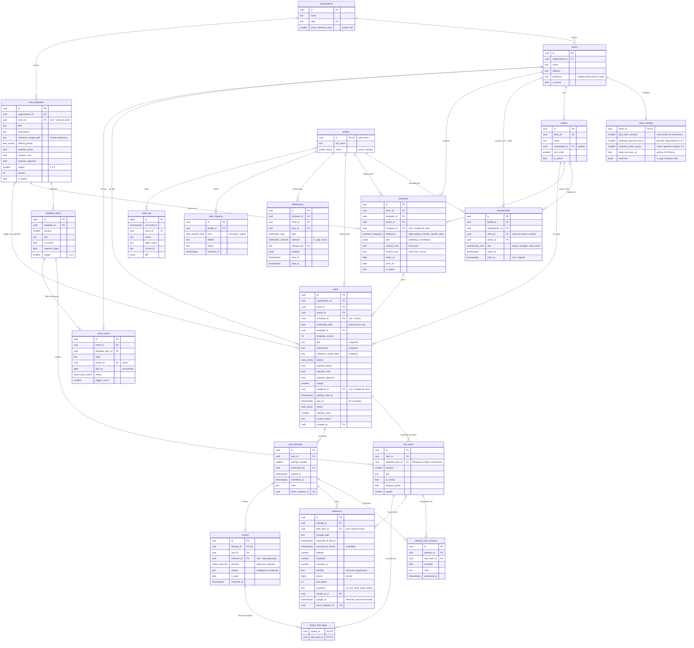
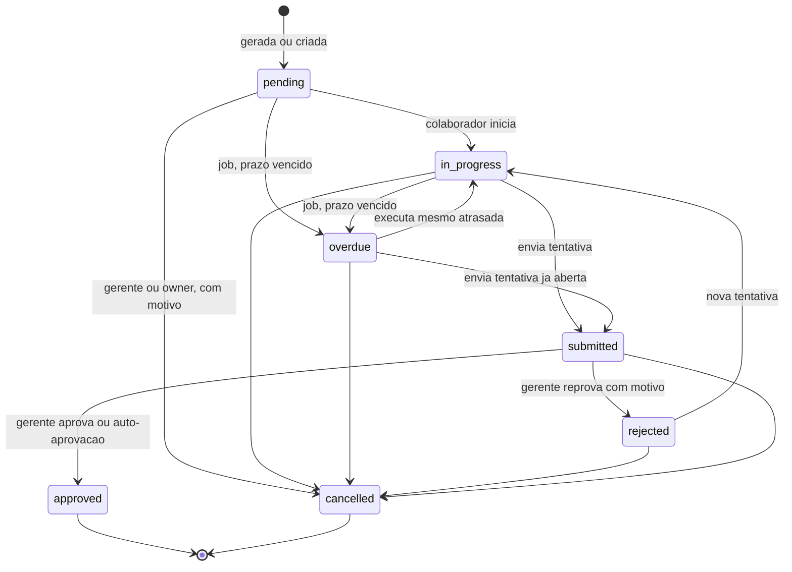

# Modelo de dados — Éde Gestão

> Proposta da Fase 0. Vira migrations em `supabase/migrations/` na Fase 1.
> Nomes em inglês `snake_case`, comentários (`COMMENT ON`) em português.
> Toda tabela tem `id uuid` (exceto `audit_log`, que usa `bigint identity` para ordem estável) e `created_at` / `updated_at` quando aplicável.
> Tabelas marcadas com ➕ não estavam na lista original; a justificativa está em `docs/decisoes.md`.

## 1. Diagrama entidade-relacionamento

Versão em imagem: [`diagramas/modelo-er.png`](diagramas/modelo-er.png) · [`diagramas/maquina-de-estados.png`](diagramas/maquina-de-estados.png).

## 2. Máquina de estados da tarefa

Implementada no banco: função `task_status_transition_allowed(old, new)` + trigger `BEFORE UPDATE OF status ON tasks`. Transição fora do grafo levanta exceção, para qualquer papel (inclusive `service_role`).

Regras adicionais no banco:

- `requires_approval = false` → no envio, a função `submit_attempt` grava `reviews(is_auto = true, reviewer_id = null, decision = 'approved')` e leva a tarefa a `approved` na mesma transação.
- `rejected` exige `reviews.reason` não vazio (`CHECK`) e incrementa a próxima tentativa (`attempt_count`).
- `cancelled` exige `cancel_reason` e papel `manager` (da loja) ou `owner`.
- `approved` e `cancelled` são terminais.
- Envio exige: todos os itens respondidos; foto em itens/tarefa com `requires_photo`; observação se `requires_note`.
- `submitted` **nunca** entra em contagem de concluídas (as views só contam `approved`).

## 3. Enums

| Enum | Valores |
|---|---|
| `membership_role` | `owner`, `manager`, `staff`, `admin` |
| `profile_status` | `active`, `inactive` |
| `task_status` | `pending`, `in_progress`, `submitted`, `approved`, `rejected`, `overdue`, `cancelled` |
| `task_priority` | `low`, `normal`, `high`, `urgent` |
| `schedule_frequency` | `daily`, `weekly`, `monthly`, `specific_days` |
| `review_decision` | `approved`, `rejected` |
| `action_plan_status` | `open`, `in_progress`, `done`, `cancelled` |
| `notification_channel` | `in_app`, `email` (push e WhatsApp entram depois por migration aditiva) |
| `notification_type` | `due_soon`, `overdue`, `correction_requested`, `recurring_reminder`, `awaiting_approval`, `escalation_manager`, `escalation_owner`, `daily_summary`, `task_cancelled`, `sync_conflict` |
| `data_request_kind` | `correction`, `export` |

## 4. Integridade e idempotência

| Regra | Como |
|---|---|
| Geração diária não duplica | `UNIQUE (schedule_id, scheduled_date)` + `INSERT … ON CONFLICT DO NOTHING` |
| Reenvio offline não duplica | `client_mutation_id uuid UNIQUE` em `task_attempts`, `evidences` e nas respostas; reenvio devolve o registro existente |
| Foto repetida é bloqueada | `UNIQUE (organization_id, sha256)` em `evidences` (vale mesmo após `purged_at`) |
| Vínculos sem sobreposição | `EXCLUDE USING gist (profile_id WITH =, store_id WITH =, tstzrange(starts_at, ends_at) WITH &&)` (extensão `btree_gist`) |
| Tentativa única por número | `UNIQUE (task_id, attempt_number)` |
| Uma revisão por tentativa | `UNIQUE (attempt_id)` em `reviews` |
| Plano de ação sem duplicar | índice único parcial `(store_id, template_item_id) WHERE status IN ('open','in_progress')` |
| Notificação sem duplicar | `dedupe_key UNIQUE` (ex.: `overdue:{task_id}`) |
| Pesos válidos | `CHECK (weight BETWEEN 1 AND 5)` |
| Snapshot | ao gerar a tarefa, copia título, instruções, imagem, flags, peso e itens do modelo; editar o modelo incrementa `version` e não toca tarefas existentes |

## 5. Imutabilidade

| Tabela | UPDATE | DELETE |
|---|---|---|
| `audit_log` | proibido (sem policy + trigger que levanta exceção) | proibido |
| `evidences` | proibido, exceto o job de retenção preencher `purged_at` | proibido |
| `reviews`, `review_item_flags` | proibido | proibido |
| `task_attempts` | só até `submitted_at` ser preenchido | proibido |

## 6. RLS — matriz alvo

Regra de ouro: **o banco protege, não a interface.** RLS habilitada em **todas** as tabelas. Funções auxiliares `SECURITY DEFINER STABLE` com `search_path` fixo:
`current_store_ids(roles)` (lojas com vínculo **vigente** nos papéis pedidos), `is_owner()`, `is_admin()`.

Mutações de execução e revisão passam por funções RPC (`start_attempt`, `submit_attempt`, `review_attempt`, `cancel_task`) que validam papel e estado. Sem policy de `UPDATE` direto em `tasks` para `staff`.

Legenda: **L** lê · **E** escreve · **F** só via função RPC · — sem acesso.

| Tabela | staff | manager | owner | admin |
|---|---|---|---|---|
| `organizations`, `stores` | L (suas lojas) | L (sua loja) | L | L E |
| `store_settings` | — | L | L E | L E |
| `sectors` | L (sua loja) | L E (sua loja) | L E | L E |
| `profiles` | L E (o próprio) | L (equipe da loja) | L | L E |
| `memberships` | L (os próprios) | L (sua loja) | L E | L E |
| `task_templates`, `template_items` | — | L E (sua loja) · L (rede) | L E | L† |
| `schedules` | — | L E (sua loja) | L E | L† |
| `tasks`, `task_items` | L (atribuídas a si ou ao seu setor, em loja com vínculo vigente) · F | L E (sua loja) · F | L E · F | L† |
| `task_attempts`, `attempt_item_answers` | L (as próprias) · F | L (sua loja) | L | L† |
| `evidences` | L (as próprias) · F | L (sua loja) | L | L† |
| `reviews`, `review_item_flags` | L (das suas tarefas) | L · F (sua loja) | L · F | L† |
| `action_plans` | L (se responsável) | L E (sua loja) | L E | L† |
| `notifications` | L, marcar lida (as próprias) | idem | idem | idem |
| `data_requests` | L E (os próprios) | — | L | L E |
| `audit_log` | — | — | L | L |

† **admin** lê dados operacionais apenas por funções `admin_read_*` que gravam a consulta no `audit_log` (um `SELECT` direto não dispara trigger, então não seria auditável). Sem policy de `SELECT` direto para admin nessas tabelas.

### Storage

| Bucket | Caminho | Acesso |
|---|---|---|
| `evidences` (privado) | `{organization_id}/{store_id}/{task_id}/{attempt_id}/{uuid}.jpg` | Upload: executor da tentativa aberta. Leitura: **só signed URL ≤ 5 min gerada no servidor**, após checar a mesma regra da tabela. Sem UPDATE/DELETE (exceto job de retenção) |
| `references` (privado) | `{organization_id}/{store_id or "rede"}/{template_id}/{uuid}.jpg` | Upload: manager (sua loja), owner, admin. Leitura: signed URL |

Policies de `storage.objects` extraem `store_id` de `(storage.foldername(name))[2]` e aplicam `current_store_ids(...)`.

### Testes de isolamento obrigatórios (Fase 1)

Com JWT simulado de cada papel (`set local role authenticated` + `request.jwt.claims`):

1. Gerente da **Primavera** lê **0 linhas** da **Castro Alves** em todas as tabelas operacionais.
2. Gerente da Primavera **não** insere, altera nem cancela tarefa da Castro Alves.
3. Gerente da Primavera **não** lista nem baixa objeto de storage da Castro Alves.
4. Colaborador com vínculo **encerrado** perde acesso imediatamente.
5. Colaborador não vê tarefa de outro setor atribuída a outra pessoa.
6. `UPDATE`/`DELETE` em `audit_log`, `evidences` e `reviews` falham para todos os papéis.
7. Transição inválida (`pending → approved`) e reprovação sem motivo falham.

## 7. Indicadores (views/funções `security invoker`)

Período sempre por **data local da loja**. Tarefas `cancelled` saem de todas as contagens.

| Indicador | Definição |
|---|---|
| Previstas | tarefas com `due_at` no período |
| Executadas | previstas com ao menos uma tentativa enviada |
| Aprovadas | previstas com `status = approved` |
| Atrasadas | não aprovadas com `due_at < now()` |
| Pendentes | não aprovadas e não atrasadas (inclui "Aguardando aprovação", exibido à parte) |
| % aprovadas na janela | aprovadas cuja tentativa aprovada foi enviada entre `window_start_at` e `due_at` ÷ previstas |
| % aprovadas na 1ª tentativa | aprovadas com `requires_approval` e tentativa aprovada = 1 ÷ aprovadas com `requires_approval` (auto-aprovadas ficam fora para não inflar) |
| Tempo atribuição → envio | média de `1º submitted_at − greatest(created_at, window_start_at)` |
| Tempo envio → revisão | média de `reviewed_at − submitted_at` nas revisões manuais |
| Devolvidas para correção | contagem de `reviews.decision = rejected` |
| Top itens reprovados | `review_item_flags` agrupado por `template_item_id`, rotina e loja |
| Nota ponderada | `Σ(peso × resultado) ÷ Σ(peso)` por loja/setor/pessoa; resultado = 1 se aprovada, 0 se não; itens críticos reprovados destacados; **sempre exibida ao lado do volume atribuído** |
| Adoção | executadas ÷ previstas |

Cada view terá teste com dados de exemplo e resultado esperado escrito no próprio teste.
